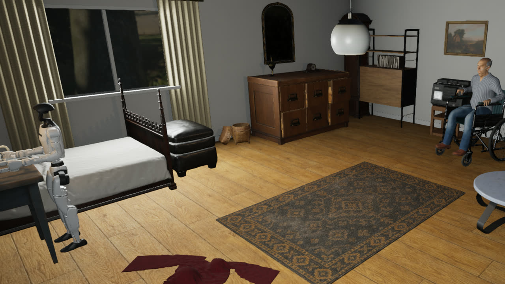
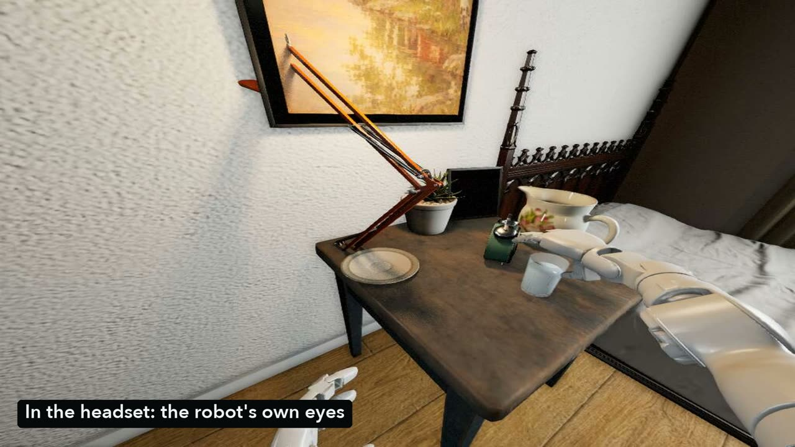
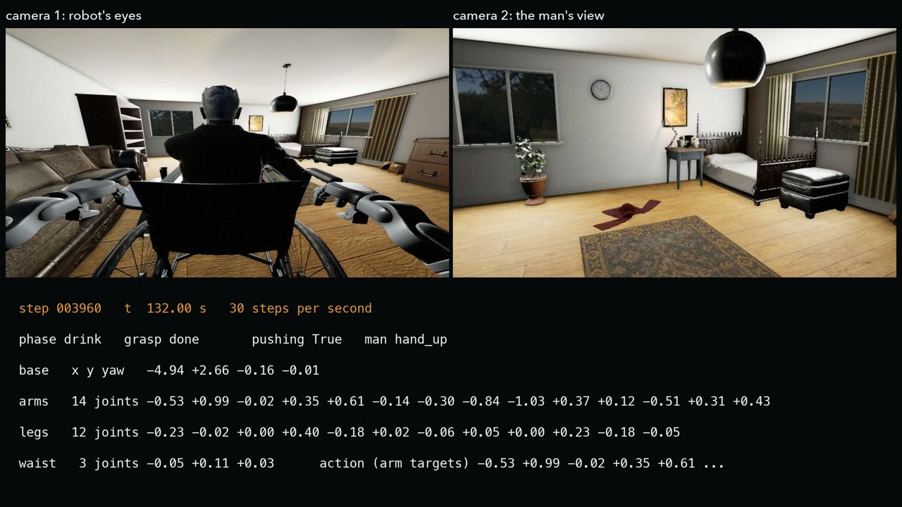

# Salamanca

**A person in a motion-capture suit drives a humanoid robot in someone else's home, and every job they do becomes
training data.** Built by team {} at Junction 2026 (Espoo, 13 to 15 November) for the Robot Teleoperation Challenge.

A man in a wheelchair rings his bell. A remote worker wearing a Rokoko suit and a Quest 3 headset becomes the
robot in his room: they pick his sweater up off the floor, bring him a glass of water, and wheel him to his bed.
While they work, a recorder saves everything the robot did and saw, in a format robot-learning models train on.



## How it fits together

```
 Rokoko suit ──UDP──▶ suit bridge ──▶ ┌────────────┐ ──UDP 30/s──▶ Unreal Engine 5.8 (the room, the robot, two cameras)
 Quest 3 (WebXR page) ◀── JPEG ───────│ robot node │                     │
        │  head pose, triggers ──────▶│   30 Hz    │ ◀── pictures ───────┘
        └─────────────────────────────└────────────┘ ──▶ recorder ──▶ episodes ──▶ LeRobot dataset
```

| Part | Where | What it does |
|---|---|---|
| Robot node | `remote_hands/robot_node.py` | The 30 Hz control loop for a Unitree G1: joint limits, reach, grasping, walking, the story of the scene. Unreal only draws what it decides. |
| Suit input | `remote_hands/rokoko.py`, `bridge.py`, `mirror.py`, `walk.py` | Reads Rokoko Studio's live stream. The robot's arms point the way the worker's do, the waist follows the torso, and steps move the robot at twice the worker's distance. |
| Grasp assist and scene | `remote_hands/grasp_assist.py`, `scene.py`, `home.py` | A trigger press near an object picks it up; another hands it over or takes hold of the wheelchair. |
| Unreal link | `unreal/RemoteHandsBedroom/Plugins/RemoteHandsLink` (C++) | Receives the robot's state over UDP, poses the robot and the objects, and serves the robot's-eye and the man's-eye pictures over HTTP. |
| The room | `unreal/RemoteHandsBedroom/Scripts/build_bedroom.py` | Builds the level from scripts: a 6.85 x 6.3 m room, daylight, furniture, the man in his wheelchair. |
| Headset view | `helper/quest.html` | A WebXR page in the Quest's browser. Head pose steers the robot's camera; triggers act. |
| Local view | `helper/mirror.html` | Both views on a laptop, with live object boxes and a strip of the data being recorded. |
| Recorder | `remote_hands/recorder.py`, `labels.py` | One episode per run: joints, actions, object positions, labels and two cameras. |
| Dataset tools | `tools/export_lerobot.py`, `tools/draw_labels.py`, `tools/label_with_nemotron.py` | Export to the LeRobot v3 format, draw boxes from recorded positions, and ask NVIDIA Nemotron to describe the frames in words. |
| Request understanding | `remote_hands/extractor.py` | Nemotron turns what the person asks for into an object for the robot, with a word-matching fallback. |



## What a recording holds

Every control step, 30 times a second:

- the robot's state: 14 arm, 14 hand, 12 leg and 3 waist joints, and where it stands in the room
- the action: the joint targets the worker's movement asked for
- where every object is and which hand holds it, the wheelchair, and what the man is doing
- labels: the task in words, the step of the story, the grasp stage, trigger presses
- the worker's own body data from the suit
- which frame of each camera belongs to that step (robot's eyes about 14 a second, the man's view about 5)



## Running it

Needs macOS or Linux, Python 3.12, Unreal Engine 5.8, and for the full loop a Rokoko suit with Rokoko Studio and a
Quest 3 on a USB cable.

```bash
python -m venv .venv && .venv/bin/pip install -r requirements.txt
```

The robot's kinematics, mock simulator and safety layer come from the Aalto humanoid challenge repository. Check
it out beside this folder as `aaltonomous-humanoid`, or point `AALTO_REPO` at it.

```bash
# 1. the pages (headset view, local view)
.venv/bin/python -m uvicorn remote_hands.session_server:app --host 0.0.0.0 --port 8000
# 2. the robot, talking to Unreal and recording
.venv/bin/python -m remote_hands.robot_node --backend mock --listen 8765 --unreal-udp 127.0.0.1:7777 --record recordings/dataset
# 3. the suit (Rokoko Studio: live stream, Custom output, JSON v3, UDP port 14043)
.venv/bin/python -m remote_hands.bridge --source studio
# 4. the headset, over USB
bash tools/quest_cable.sh
```

Open `unreal/RemoteHandsBedroom/RemoteHandsBedroom.uproject` in Unreal and load the `HomeBedroom` level; see
`unreal/README.md` for building the plugin and the level. Then open `http://localhost:8000/mirror` on the laptop
and press Enter VR in the headset.

Without a suit or headset, `tools/play_story.py` plays the whole story from a script.

```bash
.venv/bin/python -m unittest discover -s tests     # 74 tests
```

Nemotron needs `NEMOTRON_API_KEY` (or `NVIDIA_API_KEY`) in a local `.env`, which is not in this repository.

## What is not in this repository

- **Unreal content and assets.** The level, meshes and textures are rebuilt by the scripts from CC0 sources (Poly
  Haven models and textures, a MakeHuman / MPFB figure). The Unitree G1 model comes from its public URDF.
- **Recordings and videos.** The suit recordings, the exported dataset and the demo video are too large for git.
- **The crawling model.** The fine-tuning work on robot crawling was done by teammates and lives with them.

## Honest limits

- The robot is simulated: a kinematic Unitree G1 on a mock backend, not a physics simulation or a real robot.
- Object boxes come from recorded positions, not from vision, so they ignore anything in the way.
- Nemotron's descriptions of whole recordings were mixed in our runs; the dependable labels are the ones the
  system writes itself.
- End-to-end delay to the headset was not measured.

`docs/notes.md` is the working notes from the weekend, kept as they were.

## Licence

MIT, see `LICENSE`. Third-party assets keep their own licences and are not redistributed here.
